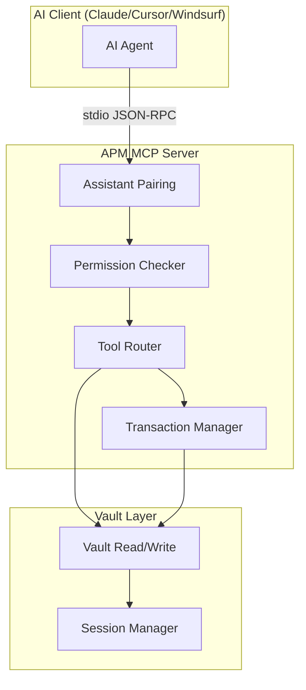
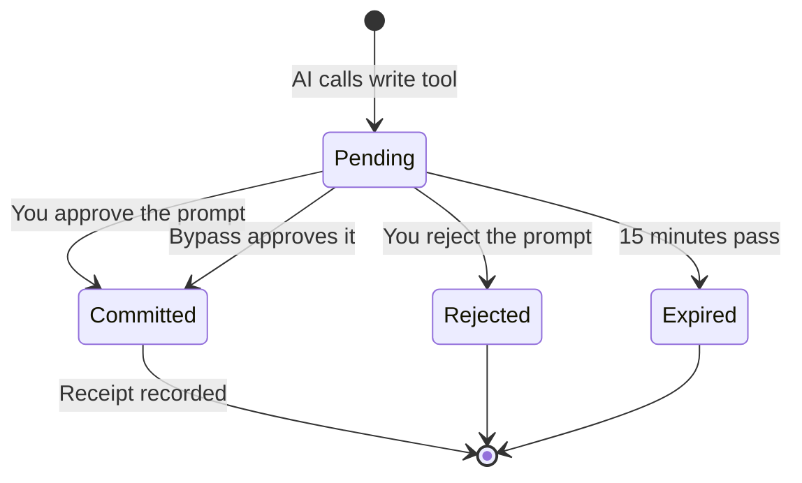

# MCP Server

APM includes a native **Model Context Protocol (MCP)** server that enables AI assistants to interact with your encrypted vault through a standardized tool-calling interface.

---

## Architecture



### Transport

The MCP server uses **stdio transport** — it reads JSON-RPC messages from stdin and writes responses to stdout. It's spawned as a subprocess by the AI client.

---

## Pairing

Assistants don't need a token. Set one up with:

```bash
pm mcp add
```

`pm mcp add` asks which assistant you use and adds APM to it: it runs the assistant's own setup command (for example `claude mcp add --scope user apm -- pm mcp serve --client claude-code`), adds an `apm` entry to its config file, or opens its install link. Every way starts `pm mcp serve --client <assistant>`.

The first time the assistant starts `pm mcp serve`, APM shows the same approval prompt as for a change: **<Assistant> wants to use your vault**, with what it gets. Touch ID or **Allow** allows it; Esc or **Don't allow** declines. Tool calls the assistant makes before you answer wait for your answer. The request expires after 2 minutes, and is withdrawn if the assistant stops first.

- **Allowed:** APM remembers the assistant, matched by the `--client` it was set up with and the name it reports when it connects (MCP `clientInfo.name`). Later sessions start without asking.
- **Not allowed or expired:** every tool returns `APM didn't allow <assistant>. Ask again by restarting <assistant>.`

Allowed assistants are kept in `mcp_assistants.json` in the APM config directory. See them with `pm mcp list` or in **Settings → AI access**.

---

## Permissions

Each tool has a permission of the same name. A newly allowed assistant may use:

| Permission          | Tool                                           |
| :------------------ | :--------------------------------------------- |
| `list_vault`        | List item names                                |
| `search_vault`      | Search items                                   |
| `get_entry`         | Read an item, secrets included                 |
| `decrypt_entry`     | Decrypt what `get_entry` returned              |
| `get_totp`          | Read a 2FA code                                |
| `generate_password` | Generate a password                            |
| `add_entry`         | Ask to add an item (you approve each one)      |
| `edit_entry`        | Ask to change an item (you approve each one)   |
| `delete_entry`      | Ask to delete an item (you approve each one)   |
| `tx_list`           | List its requests                              |
| `tx_abort`          | Withdraw one of its requests                   |

`manage_profiles`, `manage_spaces`, `cloud_config`, `cloud_sync`, `get_history` and `get_audit_logs` are off for a new assistant, because they apply without asking you. Turn them on per assistant in **Settings → AI access**. The list a new assistant gets is the `default_perms` setting (see [Settings](#settings)).

APM reads the assistant's permissions on every tool call, so a change or a revoke applies from its next call. A call without the permission returns `Denied. <assistant> isn't allowed to use <tool>.`

---

## Transaction Guardrails

Every write operation waits for **your** approval. The AI cannot approve its own changes.

### Phase 1: Request

When the AI calls a write tool (e.g., `add_entry`), APM:

1. Queues the change as a **pending request** with a unique `tx_id`. Nothing is written yet.
2. Shows an approval prompt on top of every window and Space, including full-screen apps, so you can answer without leaving what you're doing. It shows which assistant is asking and what will change, with secrets masked.
3. Waits up to 2 minutes for your answer, then returns the outcome to the AI.

### Phase 2: Your decision

Touch the Touch ID sensor or click **Approve** to approve the request; on a Mac without Touch ID, press Space. Esc or **Reject** rejects it. Only an approval executes the change, and it records a **receipt ID**. The change shows in History, where you can undo it.

The prompt belongs to the APM desktop app. If the app isn't running, `pm mcp serve` shows the prompt itself. The approved change is made by whoever has the vault open: the app if it's unlocked, otherwise `pm mcp serve` through your `pm unlock` session. If neither can, the request stays approved and the app makes the change when you next unlock the vault.

If you don't answer within 2 minutes, the call returns `Still waiting for approval` with the `tx_id`. The request stays open for 15 minutes (the `expiry_minutes` setting), and you can still answer it in the prompt or in **Settings → AI access**. The AI can check on its requests with `tx_list` or withdraw one with `tx_abort`.



### Approve with Touch ID only

With `approve_with` set to `touchid`, a Mac with Touch ID approves a request only by a touch. The **Approve** and **Allow** buttons are disabled with the hint **Touch ID required**, Space does nothing, and the app refuses an approval made any other way (`This request needs Touch ID.`). **Reject**, **Don't allow** and Esc still work. On a Mac without Touch ID, and on other systems, the setting acts like `any`. Each request keeps the setting it was made under.

### Why Guardrails?

AI agents can make mistakes. Transaction guardrails ensure:

- **No accidental mutations** — Every change requires explicit approval
- **Audit trail** — Each transaction generates a receipt ID
- **Human in the loop** — You see each change before it happens and can reject it

---

## Settings

APM keeps one set of MCP settings for every assistant in `mcp_policy.json` in the APM config directory, next to `mcp_assistants.json`. A missing file, or a missing setting, means the default. APM reads the settings on every tool call, so a change applies from each assistant's next call.

```json
{
  "paused": false,
  "approve_with": "any",
  "expiry_minutes": 15,
  "new_assistants": "ask",
  "ask_before_secrets": false,
  "default_perms": ["list_vault", "search_vault", "get_entry", "decrypt_entry", "get_totp", "generate_password", "add_entry", "edit_entry", "delete_entry", "tx_list", "tx_abort"]
}
```

| Setting              | Values                       | What it does |
| :------------------- | :--------------------------- | :----------- |
| `paused`             | `false`, `true`              | `true` refuses every tool call from every assistant: `APM has paused MCP access. Resume it in APM settings.` |
| `approve_with`       | `any`, `touchid`             | `any`: Touch ID, Space or a click approves. `touchid`: only a touch approves (see above). |
| `expiry_minutes`     | `5`, `15`, `30`, `60`        | How long a new change request stays open. Connect and read requests always last 2 minutes. |
| `new_assistants`     | `ask`, `block`               | `ask` shows the connect prompt. `block` refuses an assistant APM doesn't know, without a prompt: `APM isn't accepting new assistants. Allow them in APM settings.` |
| `ask_before_secrets` | `false`, `true`              | `true` makes `get_entry`, `decrypt_entry`, `get_totp` and `search_vault` ask first (see below). |
| `default_perms`      | tool names                   | What a newly allowed assistant may use. |

Change them in **Settings → AI access**, or with `pm mcp pause`, `pm mcp resume` and `pm mcp settings`. Making a setting stricter (pausing, Touch ID only, a shorter expiry, blocking new assistants, asking before secrets, fewer default permissions) works at any time, even while the vault is locked. Making one looser needs you there: in the app the vault must be unlocked; in the terminal pm asks for Touch ID, or your master password on a Mac without it, and refuses when it isn't run at a terminal (`Loosening MCP settings needs you at the terminal.`). Every change is logged as `MCP_POLICY_CHANGED`.

### Asking before secrets are read

With `ask_before_secrets` on, each `get_entry`, `decrypt_entry`, `get_totp` and `search_vault` call makes a read request and shows the prompt: **<Assistant> wants to read “GitHub”**, **wants a 2FA code for “GitHub”** or **wants to search your vault**. The call waits for your answer. **Allow** runs it; **Don't allow**, Esc, or no answer within 2 minutes returns `Not allowed in APM.` A read request is never applied by the app; it is closed by the `pm mcp serve` that asked. For `decrypt_entry` the request stores only the item's name, never the reference key.

### Approving an assistant's changes without asking

Each allowed assistant has a bypass setting, kept on its entry in `mcp_assistants.json` as `bypass` (`ask` or `always`) and `bypass_until` (a time, or left out):

- `ask` (the default): every add, edit and delete shows the prompt.
- `always`: its changes are approved without a prompt.
- For one hour: `bypass_until` is set an hour ahead; after that its changes ask again.

A bypassed change still makes a request, approved at once with `decided_via: "bypass"` and logged as `MCP_TX_AUTO_APPROVED`, and is applied as usual: by the app if it's unlocked, otherwise by `pm mcp serve` through your `pm unlock` session, and shows in History. Connect requests and read requests always ask. Set it in **Settings → AI access** or with `pm mcp bypass <assistant> ask|always|1h`; turning a bypass on needs you there, like loosening a setting. Changes are logged as `MCP_ASSISTANT_BYPASS`.

---

## Revoking an assistant

```bash
pm mcp revoke "Claude Code"
```

`pm mcp revoke` takes the assistant's name or id from `pm mcp list`. You can also revoke it in **Settings → AI access**. A running assistant is denied from its next tool call. Restart it to ask again.

---

## Legacy tokens

Setups made before pairing use a token: `pm mcp serve --token <token>`. These keep working with the token's permissions, which are fixed when the server starts. Tokens are kept in `mcp_auth.json` in the APM config directory, listed under **Legacy tokens** in `pm mcp list`, and revoked with `pm mcp revoke <name>`. `pm mcp token` still creates one, but new setups should use `pm mcp add`.

The legacy scopes map to tools:

| Scope     | Tools                                                                  |
| :-------- | :--------------------------------------------------------------------- |
| `read`    | `list_vault`, `search_vault`                                           |
| `secrets` | `get_entry`, `decrypt_entry`, `get_totp`                               |
| `write`   | `add_entry`, `edit_entry`, `delete_entry`, `manage_spaces`, `cloud_sync` |
| `admin`   | `manage_profiles`, `cloud_config`, `get_history`, `get_audit_logs`     |

---

## Session Integration

The MCP server requires an active APM session to access vault data:

- **Regular session** — The MCP server uses the same session as the CLI (`pm unlock`)
- **Ephemeral session** — Set `APM_EPHEMERAL_ID` for host/PID/agent-bound delegation

!!! tip
    For production deployments, use ephemeral sessions with host binding to restrict MCP access to the specific machine running the AI client.

---

## Next Steps

- **[MCP Tools Reference](../reference/mcp-tools.md)** — All tool schemas and permissions
- **[MCP Integration Guide](../guides/mcp-integration.md)** — Setup for Claude, Cursor, Windsurf